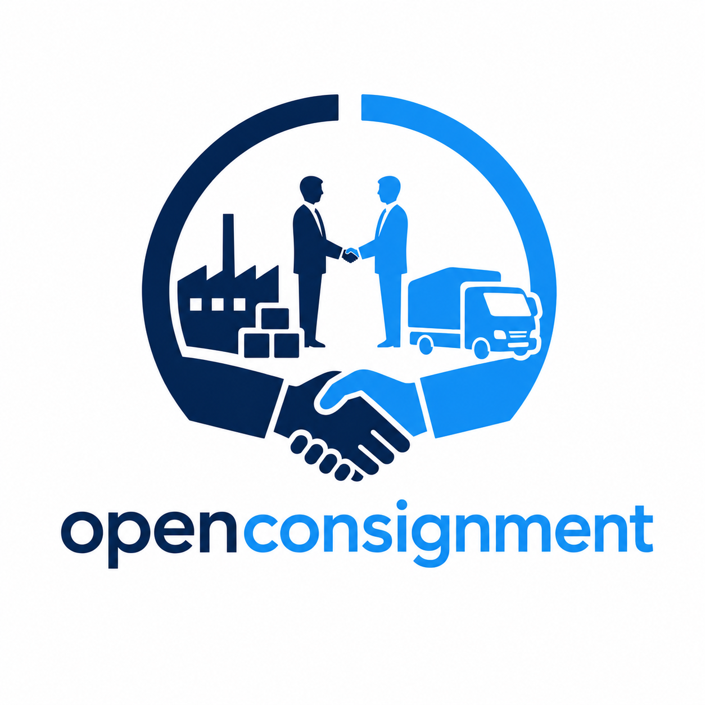

# OpenConsignment

[](https://github.com/razdeep/openconsignment/actions/workflows/build.yml)
[](https://github.com/razdeep/openconsignment/actions/workflows/release.yml)
[](https://codecov.io/gh/razdeep/openconsignment)
[](LICENSE)
[](https://openjdk.org/projects/jdk/17/)
[](https://openjfx.io/)



OpenConsignment is a JavaFX desktop application for managing consignment sale
data — buyers, suppliers, transports, bills, collections, and payments — with
SQLite storage and PDF ledger reports.

## Features

- **Master data** — maintain buyers, suppliers, and transports.
- **Bill entry** — record consignment bills, including LR (lorry receipt)
  details, with an editable history view.
- **Collections & payments** — record buyer collections and supplier
  payments against pending bills, with dedicated history views.
- **Ledger reports** — generate buyer, supplier, and transport ledgers as
  PDFs (via JasperReports), including agewise-outstanding variants.
- **Local-first storage** — data is kept in a local SQLite database
  (`database.db`), with built-in Git backup actions and separate backup
  helper scripts (see [Backups](#backups)).

## Tech stack

- Java 17, JavaFX 17
- [Dagger 2](https://dagger.dev/) for dependency injection (see
  `src/main/java/openconsignment/di`)
- SQLite (via `sqlite-jdbc`) for storage
- JasperReports for PDF report generation
- JGit for built-in Git backup operations; SnakeYAML for configuration
- SLF4J with Log4j 2 for asynchronous rolling-file logging
- Gradle (Kotlin DSL) with the Shadow plugin for a single runnable JAR
- JUnit 5, Mockito, and TestFX for testing; Spotless (`palantir-java-format`)
  for formatting; JaCoCo for coverage

## Architecture

OpenConsignment is a local desktop application. Its typical request flow is:

```text
JavaFX FXML / CSS
    ↓
Controllers (entry, history, master, report)
    ↓
Services (domain operations and report preparation)
    ↓
Repositories → SQL resources → SQLite database.db

Services → JasperReports templates → report.pdf → system PDF viewer
MainController → BackupService → JGit / backup repository
```

- **Startup and dependency injection:** `Launcher` creates the Dagger
  `AppComponent`, validates configuration, and loads `Main.fxml` with the
  Dagger controller factory. `DatabaseModule`, `ConfigurationModule`, and
  `ControllerModule` provide the shared dependencies and controller bindings.
- **Presentation:** FXML defines the screens and binds them to JavaFX
  controllers. `MainController` handles top-level navigation, while
  `ViewLoader` loads nested or center views with animated transitions.
  Controllers handle form state, validation, user feedback, and calls to
  services; some also invoke shared utilities directly.
- **Domain and persistence:** Services coordinate repositories and prepare
  data for reports. Repositories use JDBC through the shared, lazily opened
  `DatabaseManager` connection and load queries from `sql/` via `SqlQuery` and
  `SqlLoader`. Entities represent persisted bills, vouchers, and their items;
  models include UI table rows and ledger/report rows.
- **Transaction boundaries:** Bill, collection, and payment saves replace the
  existing header and associated LR or voucher items in a single transaction.
  Their deletes also cover header and item rows in one transaction.
  `WriteTransaction` commits on success and attempts rollback on failure,
  restoring auto-commit when it was enabled and the transaction ended safely.
  It owns the write on the shared connection, not a nested transaction. Payment
  save failures are reported without clearing the entered form, so the user can
  retry.
- **Balances and reports:** Pending buyer collections and supplier payments
  are calculated by SQL from bill amounts and recorded voucher items. Services
  prepare ledger rows and report parameters; `Utils.generatePdf` compiles the
  bundled JRXML, fills it with the data, and exports `report.pdf`.
- **Backup and logging:** Built-in backup actions run through `BackupService`
  using JGit; the separate scripts use the Git CLI. SLF4J/Log4j 2 provides
  application logging. See [Backups](#backups) for important limitations.

## Getting started

### Prerequisites

- JDK 17, with `java` available on your `PATH`.
- A graphical desktop environment to run the application, and a PDF viewer
  to open generated reports.

The repository includes the Gradle wrapper; a separate Gradle installation
is not required. Gradle resolves JavaFX dependencies when running from source.

### Run from source

```shell
./gradlew run
```

Run commands from the repository root. On Windows, use `gradlew.bat` in
place of `./gradlew`.

### Build a runnable JAR

```shell
./gradlew shadowJar
```

This produces `build/libs/OpenConsignment.jar` and copies the launch scripts,
backup configuration script, and backup templates into `build/libs/`.
The launch scripts require a separate JavaFX 17 SDK matching your operating
system and CPU architecture.

On macOS/Linux, the launcher defaults to `~/javafx-sdk-17.0.19/lib`:

```shell
bash build/libs/start.sh
```

To use a different SDK location, set `JAVAFX_MODULE_PATH` to its `lib` directory:

```shell
JAVAFX_MODULE_PATH="/path/to/javafx-sdk-17/lib" bash build/libs/start.sh
```

On Windows, edit `build/libs/start.bat` to match your local Java and JavaFX
installations, then run it from `build/libs/`:

```bat
cd build\libs
start.bat
```

The batch script currently sets Java to `C:\Program Files\Java\jdk-17`
and the JavaFX module path to `%USERPROFILE%\javafx-sdk-17.0.18\lib`.
Keep the JAR and launch script together when moving the application.

## Data and reports

- The application creates and initializes `database.db` in its working
  directory using `src/main/resources/sql/init.sql`.
- Repository queries live in domain-specific folders under
  `src/main/resources/sql` (for example, `bill/get.sql`). Paths are registered
  in the `SqlQuery` enum and loaded with `SqlLoader.load(SqlQuery.BILL_GET)`,
  using UTF-8 decoding and caching. When adding a query, add its SQL file and
  enum entry; tests verify that every entry has a non-empty resource.
- Running `./gradlew run` uses the repository root; the packaged launch
  commands above use `build/libs/`. Each location has its own database.
- Reports are written to `report.pdf` in the working directory, replacing
  the previous report, and opened with the system's default PDF viewer.

## Application configuration

At startup, the application reads UTF-8 `application.yaml` beside the JAR, regardless
of the current working directory. If this file does not exist, the application copies
`src/main/resources/application.yaml` from inside the JAR to that location and loads
the new file. Existing configuration files are never overwritten.

Edit the generated file to set your organization name:

```yaml
organization: "YOUR ORGANIZATION"
```

This name appears on the welcome screen and in buyer, supplier, and transport
ledger reports. The bundled YAML is used only as the template for first-run creation;
properties are not merged or filled in from it when an external file already exists.
YAML is bound directly to configuration POJOs using SnakeYAML. Quote the name to
preserve its exact text; scalar values such as numbers are converted to strings.
Surrounding whitespace is trimmed. A blank or null name, malformed YAML, or an
unreadable configuration file is reported as a startup error. An empty file or missing
required property also fails validation. The application needs write access to the
JAR directory when creating the file for the first time.

For Gradle/IDE runs, the file is created and read in the working directory (the
repository root for `./gradlew run`). The template is packaged inside the JAR.
Restart the application after editing the file. Updating the JAR does not replace
an existing configuration file.

## Logging

The application writes INFO and higher messages to stderr and to
`logs/openconsignment.log` in its working directory. Application logging uses
SLF4J directly with Log4j 2 as its backend, including exception stack traces.
Use SLF4J's `LoggerFactory` and parameterized messages in application code.

The file is rolled at startup, daily, or when it reaches 10 MB. Archives are
compressed; during rollover, archives older than 30 days or beyond 100 MB total
are deleted. The active file is separate from that archive limit. File writes use
a bounded asynchronous queue; if it fills, callers wait rather than dropping
messages. The queue is drained on normal JVM shutdown. An abrupt termination
may lose queued messages. Log4j reports file setup problems to stderr, where
console logging remains available.

The working directory is the repository root when using `./gradlew run` and
`build/libs` when using the supplied launch scripts. To use a different
directory or file size, pass JVM properties, for example:

```shell
java -Dopenconsignment.logDir=/path/to/logs -Dopenconsignment.logSize="20 MB" ...
```

Configure these options in the launch script when running the packaged JAR.
Use a separate log directory for each simultaneous application instance;
the rolling files are not coordinated across processes. Log files can contain
exception details, so restrict access and review them before sharing.

## Testing

```shell
./gradlew test
```

- **Unit and integration tests** (`src/test/java/openconsignment`) cover
  configuration, utilities, services, and repositories. Repository tests use
  in-memory SQLite initialized from `src/main/resources/sql/init.sql`, including
  transaction rollback and multi-voucher balance checks; service tests mock
  their collaborators and PDF generation where appropriate.
- **Functional tests** (`src/test/java/functional`) use TestFX for FXML layout,
  navigation transitions, entry and master workflows, and report actions.

Tests run headlessly by default. To debug with visible JavaFX windows:

```shell
./gradlew test -PheadlessTests=false
```

To run a specific group of tests:

```shell
./gradlew test --tests 'openconsignment.service.*'
./gradlew test --tests 'openconsignment.repository.*'
./gradlew test --tests 'functional.*'
```

Every `test` run also produces a JaCoCo coverage report at
`build/reports/jacoco/test/html/index.html`. The test results are available at
`build/reports/tests/test/index.html`.

The build workflow uploads the JaCoCo XML report to Codecov; the badge at the
top of this README shows coverage for the default branch. To enable it, add the
repository in Codecov and configure its upload token as the GitHub Actions
repository secret `CODECOV_TOKEN`. Fork pull requests do not receive repository
secrets; their uploads require Codecov's tokenless upload support to be enabled
where applicable. Upload failures do not fail the build, so check the Codecov
step logs if coverage is missing. The badge appears after Codecov receives a
report for the default branch.

## Code style

Formatting is enforced by Spotless and checked on every build
(`spotlessJavaCheck`). To auto-format:

```shell
just format
# or: ./gradlew spotlessApply
```

## Project structure

```
src/main/java/openconsignment/
├── di/           Dagger modules and components (wires the object graph,
│                 including JavaFX's controller factory)
├── controller/   JavaFX FXML controllers, grouped by feature area
├── service/      Business logic, one per domain (bill, buyer, supplier, ...)
├── repository/   JDBC/SQL access, one per domain
├── entity/       Persistence-shaped data classes
├── model/        UI table and report row classes
├── common/       View loading, configuration, SQL loading, PDF utilities, ...
└── exception/    Application-specific exceptions
src/main/resources/
├── fxml/         JavaFX view definitions
├── jrxml/        JasperReports report templates
├── css/          Shared and feature-specific stylesheets
├── icons/        Application and toolbar icons
├── sql/          Schema and domain-specific SQL queries
├── application.yaml  First-run configuration template
└── log4j2.xml    Logging configuration
src/test/java/
├── openconsignment/  Common, service, repository, and DI tests
└── functional/       JavaFX workflow, layout, and navigation tests
scripts/              Launchers and financial-year backup helpers
gradle/libs.versions.toml  Dependency and plugin versions
```

## Backups

The application's **check sync**, **upload**, and **download** actions use
`BackupService` and JGit with the `github` settings in `application.yaml`:
`repository`, `username`, `token`, `branch`, and `remote`. The repository
setting is also used as the local checkout path. Check sync pulls and compares
the local and checkout database hashes; upload copies the local database into
an existing checkout, commits changes, and pushes; download pulls and replaces the
local database after closing its connection. These actions run in the
background. Download overwrites local data, so keep an independent backup before
using it.

**Security warning:** the current built-in backup implementation logs the
configured GitHub token during pull and push. Avoid using these actions until
this is fixed; restrict access to existing logs and rotate
any token that may have been exposed. Configuration files containing tokens
should also be kept private.

### Backup helper scripts

`scripts/configure-backup.py` generates year-scoped `upload`/`download`
scripts (from `scripts/templates`) for backing up `database.db` to a
private, per-financial-year Git repository. It requires Python 3, Git, and
SSH access to the backup repository. The repository must already exist;
the script clones it rather than creating it.

The repository owner is currently hard-coded as `drcbabu81` in
`configure-backup.py`, with repository names such as
`Satyam-Database-2026-27`. Update the owner for your deployment.

After building the JAR, run the configuration script from `build/libs/`
so it can find `templates/` and create the helpers beside `database.db`:

```shell
cd build/libs
python3 configure-backup.py
```

Enter a financial year such as `2026-27` when prompted. On Windows, use
`python configure-backup.py` from the same directory. The script generates
`upload.sh`/`download.sh` on macOS/Linux or `upload.bat`/`download.bat` on
Windows. Run the generated helpers from that directory.

Review the templates before use: the shell upload template currently uses
a Windows-style separator in its database copy destination, which needs
adjusting for macOS/Linux. The download helper replaces the local
`database.db` with the repository copy. Backup scheduling is managed separately.

## CI/CD

GitHub Actions builds and tests every push/PR (`.github/workflows/build.yml`).
Pushing a `v*` tag builds and publishes a shadow JAR to a GitHub Release
(`.github/workflows/release.yml`).

## License

[GPL-3.0](LICENSE)
